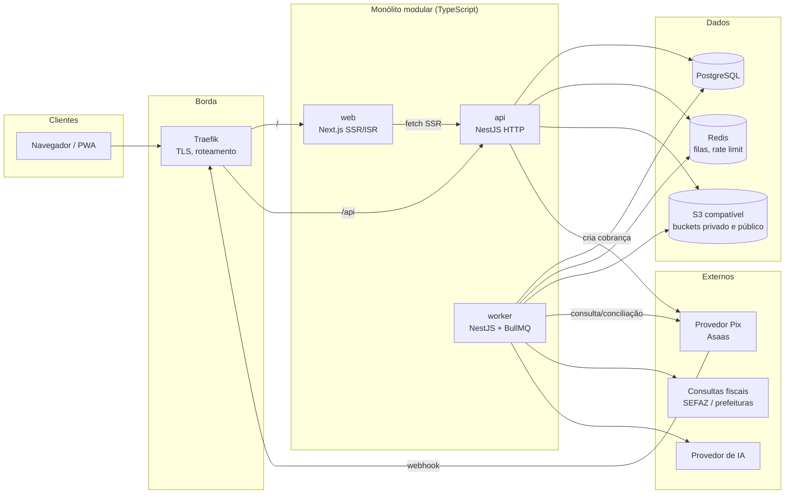
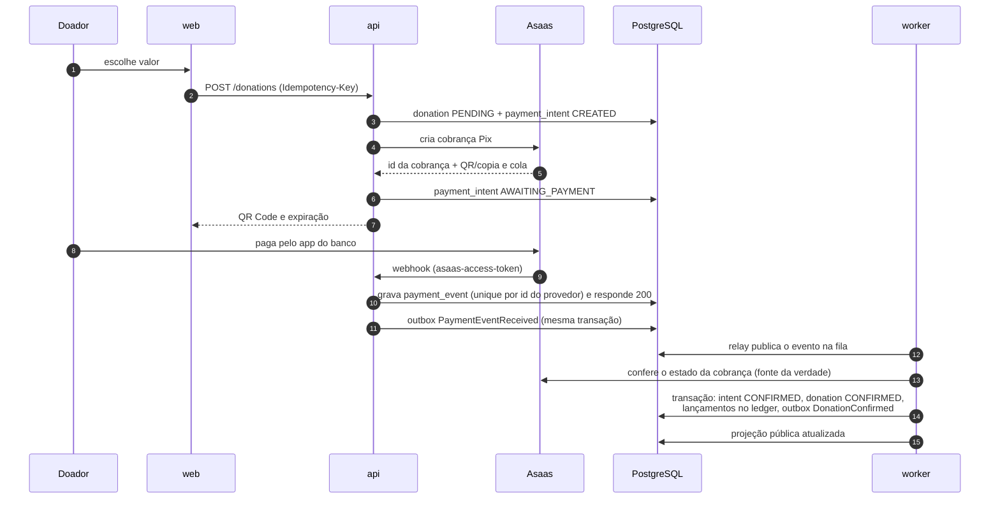
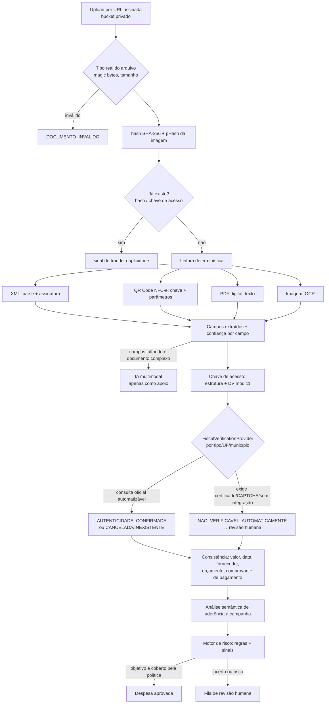

# Arquitetura

Plataforma brasileira de doações com prestação de contas verificável. Este
documento descreve o estado de partida, a arquitetura escolhida e as regras que
mantêm o código simples à medida que cresce. Decisões pontuais ficam nos ADRs em
[`docs/decisions`](decisions).

## 1. Diagnóstico do ponto de partida (outubro/2026)

Havia dois repositórios separados e três versões divergentes do produto:

| Origem | Stack | O que tinha |
|---|---|---|
| `SOSComidaService` `main` | .NET 10, EF Core, PostgreSQL (Supabase) | JWT com refresh token, cadastro, campanhas, mapa do DF |
| `SOSComidaService` `feat/ocr-notas-fiscais-e-banco-local` | .NET 9, SQLite | OCR de nota fiscal (Tesseract), prestação de contas simples |
| `SOSComidaService` `fix/seguranca-e-melhorias` | .NET 9, SQLite | autorização por token, hash de senha, auditoria de moderação, testes |
| `SOSComidaFront` `main` | Next 16, Tailwind 3 | redesign com design tokens, PWA, Capacitor (Android), mapa do DF |
| `SOSComidaFront` `fix/seguranca-e-melhorias` | Next 16 | hooks React Query, guarda de rotas, telas ligadas à API |

Problemas estruturais encontrados nessa base, que a nova arquitetura resolve
desde o início:

- **Dinheiro sem rastreabilidade.** A doação somava direto em
  `Campanha.ValorArrecadado` (`decimal` convertido para `double` no SQLite), sem
  pagamento real, sem conciliação e sem histórico imutável.
- **"Verificado" como booleano.** A nota fiscal tinha só `Revisado`; não havia
  distinção entre documento lido, autenticidade fiscal e pagamento conciliado.
- **Telas que fingiam salvar.** Edição de campanha, gestão de moderadores e
  histórico de doações eram mock (corrigido na branch `fix`, mas o modelo de
  dados não suportava o produto pretendido).
- **Módulos acoplados.** Controllers com 700 linhas acessando o `DbContext`
  diretamente; regras de permissão espalhadas.
- **Histórico do git com dados pessoais** (senhas e CPFs em `Data/*.txt`).
  Ver [SECURITY.md](SECURITY.md#incidente-herdado).

**Decisão (com o dono do produto):** novo monorepo em TypeScript (NestJS +
Next.js). O que se aproveita da base antiga: o extrator de campos de nota
fiscal (e seus testes), as regras de permissão por campanha, o design system
do front `main` e o conhecimento de domínio (regiões do DF, fluxo de
moderação). Os repositórios .NET ficam como referência e não recebem novas
funcionalidades.

## 2. Visão geral

Monólito modular com dois processos a partir do mesmo código:

- **api** — HTTP (REST + OpenAPI), autenticação, regras de negócio.
- **worker** — mesmo código, outro entrypoint: relay do outbox, jobs BullMQ
  (webhooks de pagamento, expiração de cobranças, OCR, consulta fiscal, IA,
  notificações, conciliação).

Os dois processos compartilham módulos de domínio, o banco PostgreSQL e o
Redis. Separar o worker em outro container permite escalar o processamento de
documentos sem escalar a API, sem dividir o código em serviços.



### Por que não microsserviços

O volume previsto para os estágios 1 e 2 (ver [DEPLOYMENT.md](DEPLOYMENT.md))
cabe com folga em uma VPS. Microsserviços trariam transações distribuídas
justamente no ponto mais sensível (dinheiro). Os limites de módulo abaixo
permitem extrair `payments` ou o processamento de documentos quando houver
motivo operacional medido — não antes.

## 3. Módulos de domínio

Cada módulo vive em `apps/api/src/modules/<modulo>` e expõe **apenas** o que
está em `index.ts` (fachada). Fases indicam quando o módulo ganha código.

| Módulo | Responsabilidade | Fase |
|---|---|---|
| `identity` | cadastro, login, sessões, MFA, papéis | 0 |
| `users` | perfil, preferências, dados pessoais | 1 |
| `audit` | trilha imutável de operações sensíveis | 0 |
| `campaigns` | campanhas, orçamento, máquina de estados, atualizações | 1 |
| `moderation` | fila de análise, decisões, casos | 1 |
| `donations` | intenção de doar, histórico do doador | 1 |
| `payments` | provedores Pix, cobranças, webhooks, conciliação | 1 |
| `ledger` | razão de dupla entrada, saldos | 1 |
| `storage` | uploads por URL assinada, validação de arquivo | 1 |
| `transparency` | projeções públicas (painéis, indicadores) | 1→2 |
| `outbox` | publicação confiável de eventos | 0 |
| `organizations` | ONGs e membros | 2 |
| `expenses` | despesas, alocações, estados de comprovação | 2 |
| `fiscal-documents` | leitura de XML/QR/PDF/OCR, itens | 2 |
| `fiscal-verification` | provedores de consulta fiscal | 2 |
| `fraud-detection` | sinais, regras, score | 3 |
| `ai-analysis` | análise semântica de aderência | 3 |
| `disputes` | contestação e recursos | 3 |
| `notifications` | e-mail e notificações internas | 1→2 |
| `administration` | configurações, políticas de risco | 3 |

### Regras de dependência (verificadas pelo ESLint)

1. Um módulo só importa outro pelo `index.ts` dele
   (`@/modules/ledger`), nunca por caminhos internos
   (`@/modules/ledger/domain/...`). A regra `no-restricted-imports` em
   `apps/api/eslint.config.mjs` reprova o build se isso acontecer.
2. Dependências são acíclicas e seguem a ordem abaixo (quem está acima pode
   depender de quem está abaixo, nunca o contrário):

   ```
   transparency, moderation
     → donations → payments → ledger
     → campaigns → storage
     → identity, audit, outbox → infra (db, config, observability)
   ```
3. Comunicação que não precisa ser síncrona passa por **eventos de domínio**
   gravados no outbox na mesma transação (ex.: `DonationConfirmed` atualiza a
   projeção pública sem que `payments` conheça `transparency`).
4. Tabelas pertencem a um módulo. Outro módulo não escreve nelas; leitura
   cruzada só via fachada (ou view de projeção).
5. `packages/contracts` contém **apenas** schemas Zod de entrada/saída HTTP e
   tipos derivados. `packages/shared` contém funções puras sem dependências de
   runtime (dinheiro, CPF/CNPJ, chave de acesso). Nenhum dos dois importa nada
   de `apps/*`.

### Camadas dentro de um módulo

```
modules/campaigns/
  index.ts            fachada pública (o que outros módulos podem usar)
  campaigns.module.ts
  domain/             regras puras (máquina de estados, invariantes) — sem Nest, sem banco
  application/        casos de uso (orquestram domínio + repositórios + eventos)
  infra/              tabelas Drizzle, repositórios
  http/               controllers e mapeamento de contratos
```

Domínio puro é o que tem testes unitários e de propriedade; `application` tem
testes de integração com banco real.

## 4. Fluxo financeiro (Fase 1)



Princípios garantidos:

- **Só o provedor confirma pagamento.** O retorno do navegador nunca muda
  estado financeiro. O webhook só é aceito com o token configurado e, mesmo
  assim, o worker **consulta o provedor** antes de confirmar (protege contra
  webhook forjado e evento fora de ordem).
- **Idempotência em três níveis:** `Idempotency-Key` na criação da doação;
  `UNIQUE(provider, provider_event_id)` nos eventos; `UNIQUE(idempotency_key)`
  nas transações do ledger (`donation:<id>:confirmed`).
- **Transições monotônicas:** `payment_intents` só avança
  (`CREATED → AWAITING_PAYMENT → CONFIRMED → REFUNDED`); evento atrasado que
  tentaria voltar o estado é registrado e ignorado.
- **Ledger de dupla entrada, só inserção.** Correções são lançamentos
  compensatórios. Detalhes em [PAYMENTS.md](PAYMENTS.md).
- **Sem custódia simulada.** O ledger registra o que o provedor reportou; ele
  não prova que o dinheiro está disponível. Retenção ou liberação condicional
  fica desligada até haver parceiro e contrato adequados
  ([ADR 0009](decisions/0009-sem-escrow-simulado.md)).

## 5. Fluxo de validação fiscal (Fase 2)



Cada etapa grava seu próprio resultado (origem, método, horário, evidência);
não existe um campo `verified`. Ver [FISCAL_VALIDATION.md](FISCAL_VALIDATION.md).

## 6. Estrutura de diretórios

```
apps/
  api/                 NestJS — entrypoints main.ts (HTTP) e worker.ts (jobs)
    src/modules/       módulos de domínio (seção 3)
    src/infra/         db, config, observabilidade, filas, http comum
    drizzle/           migrações SQL versionadas
    test/              testes de integração (Postgres e Redis reais)
  web/                 Next.js App Router
packages/
  config/              tsconfig e ESLint base
  contracts/           schemas Zod da API (web e api usam os mesmos)
  shared/              dinheiro, CPF/CNPJ, chave de acesso — funções puras
infra/
  docker/              compose de dev e de produção, Dockerfiles
  scripts/             backup, restore, seed de dev
  monitoring/          Prometheus e alertas
docs/                  este documento, ADRs, runbooks
tests/e2e/             Playwright (fluxos ponta a ponta)
```

Diferenças em relação à estrutura sugerida no briefing, com motivo:

- **Sem `apps/worker` separado:** o worker é outro entrypoint de `apps/api`
  ([ADR 0007](decisions/0007-worker-no-mesmo-pacote.md)). Um pacote à parte
  obrigaria a mover todo o domínio para pacotes compartilhados, criando
  exatamente o "pacote genérico gigante" que o briefing quer evitar.
- **Sem `packages/ui` por enquanto:** só existe um consumidor (`apps/web`).
  O pacote nasce quando surgir o segundo (painel administrativo separado,
  app nativo).

## 7. Decisões tecnológicas

| Tema | Escolha | Motivo resumido | ADR |
|---|---|---|---|
| Monorepo | pnpm workspaces + Turborepo | contratos compartilhados, cache de build/test | 0001 |
| Backend | NestJS 12 (CommonJS) | módulos e DI nativos, guards para RBAC, OpenAPI | 0002 |
| ORM | Drizzle | SQL explícito: `CHECK`, índices parciais, `FOR UPDATE SKIP LOCKED`, migrações em SQL revisável | 0003 |
| Sessão | sessão opaca em cookie httpOnly, guardada com hash no banco | revogação imediata, sem token em `localStorage` | 0004 |
| Dinheiro | inteiro em centavos (`bigint`), ledger de dupla entrada só inserção | sem ponto flutuante, correção por compensação | 0005 |
| Eventos | outbox transacional + BullMQ | entrega pelo menos uma vez, retries, DLQ | 0006 |
| Worker | mesmo pacote, outro processo | domínio único, escala separada | 0007 |
| Pix | Asaas primeiro, atrás de `PaymentProvider` | sandbox gratuito, webhook com token | 0008 |
| Custódia | não simular escrow | exige parceiro regulado | 0009 |
| IA | interface `LlmProvider`, saída validada por Zod | troca de fornecedor sem tocar o domínio | 0010 (Fase 3) |
| Validação | Zod (contratos) | mesma regra no front e no back | 0001 |
| Observabilidade | pino (JSON) + correlation id + Prometheus | barato e padrão de mercado | — |
