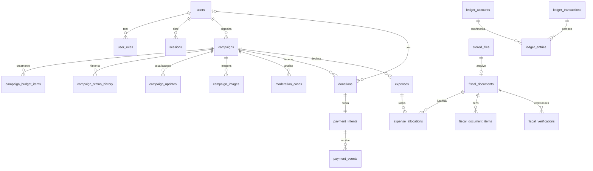

# Banco de dados

PostgreSQL 17. Esquema único `public`, tabelas com prefixo do módulo dono
quando o nome sozinho seria ambíguo. Migrações em SQL versionado
(`apps/api/drizzle/`), geradas pelo Drizzle Kit e revisadas antes do commit —
constraints e triggers que o gerador não expressa são adicionados à mão na
própria migração.

## Convenções

- **IDs:** `uuid` v7 gerado na aplicação (ordenável por tempo, bom para índice
  e não revela volume como um serial).
- **Datas:** `timestamptz`, sempre UTC.
- **Dinheiro:** `bigint` em centavos (`*_cents`), com `CHECK (x >= 0)` ou
  `> 0` conforme o caso. Nunca `numeric` para cálculo e nunca `float`.
- **Estados:** `text` com `CHECK (status IN (...))`. A máquina de estados fica
  no domínio; o banco só impede valores fora da lista.
- **Soft delete:** só onde faz sentido de produto (`campaigns`, `users`).
  Registros financeiros, fiscais e de auditoria **nunca** são apagados nem
  alterados.
- **Dados pessoais:** CPF/CNPJ guardados cifrados quando forem necessários
  (Fase 2); nas tabelas da Fase 1 só e-mail e nome. Logs nunca recebem esses
  campos ([SECURITY.md](SECURITY.md)).

## Relacionamentos (Fases 0–2)

## Tabelas por fase

### Fase 0 — fundação

| Tabela | Colunas principais | Integridade |
|---|---|---|
| `users` | id, email (citext), name, password_hash, email_verified_at, mfa_secret_enc, mfa_enabled_at, disabled_at, created_at | `UNIQUE(email)` |
| `user_roles` | user_id, role | `PK(user_id, role)`, `CHECK role IN ('moderator','admin','auditor')`. Doador é o padrão; organizador/beneficiário são relações com a campanha, não papéis globais |
| `sessions` | id, user_id, token_hash, created_at, expires_at, last_seen_at, revoked_at, ip, user_agent, mfa_verified | `UNIQUE(token_hash)`; índice em `user_id` |
| `audit_events` | id, actor_user_id, action, target_type, target_id, metadata (jsonb, sem dados pessoais), ip, request_id, occurred_at | **trigger bloqueia UPDATE/DELETE** |
| `outbox_events` | id, type, aggregate_type, aggregate_id, payload, created_at, available_at, attempts, locked_until, published_at, last_error | índice parcial `WHERE published_at IS NULL` |

### Fase 1 — campanhas e doações

| Tabela | Colunas principais | Integridade |
|---|---|---|
| `campaigns` | id, slug, organizer_id, title, summary, description, category, goal_cents, status, region, starts_at, ends_at, published_at, closed_at, version, created_at, updated_at, deleted_at | `UNIQUE(slug)`, `CHECK goal_cents > 0`, `CHECK category IN (...)`, `CHECK status IN (...)`, `CHECK ends_at > starts_at`; `version` para concorrência otimista |
| `campaign_budget_items` | id, campaign_id, category, description, planned_cents, position | `CHECK planned_cents > 0`; soma = meta é regra de domínio (validada no envio para análise) |
| `campaign_status_history` | id, campaign_id, from_status, to_status, actor_user_id, reason, occurred_at | só inserção |
| `campaign_updates` | id, campaign_id, author_id, title, body, created_at | |
| `campaign_images` | id, campaign_id, file_id, position | |
| `stored_files` | id, owner_user_id, bucket, object_key, mime_type, size_bytes, sha256, status (`PENDING_UPLOAD`,`VALIDATED`,`REJECTED`), purpose, created_at | `UNIQUE(bucket, object_key)` |
| `moderation_cases` | id, campaign_id, kind, status, assigned_to, decision, reason, opened_at, closed_at | um caso aberto por campanha e tipo: índice único parcial `WHERE status <> 'CLOSED'` |
| `donations` | id, campaign_id, donor_user_id (nulo para visitante), donor_display_name, is_anonymous, amount_cents, status, idempotency_key, created_at, confirmed_at | `CHECK amount_cents BETWEEN 100 AND 100000000`, `UNIQUE(idempotency_key)` |
| `payment_intents` | id, donation_id, provider, provider_payment_id, method, amount_cents, fee_cents, net_cents, status, pix_copy_paste, expires_at, confirmed_at, refunded_at, version | `UNIQUE(donation_id)`, `UNIQUE(provider, provider_payment_id)`, `CHECK fee_cents <= amount_cents` |
| `payment_events` | id, provider, provider_event_id, event_type, provider_payment_id, payload (jsonb sanitizado), status, attempts, received_at, processed_at, last_error | **`UNIQUE(provider, provider_event_id)`** — base da idempotência de webhook |
| `ledger_accounts` | id, code, kind (`ASSET`,`LIABILITY`,`REVENUE`,`EXPENSE`), campaign_id, created_at | `UNIQUE(code)` |
| `ledger_transactions` | id, kind, idempotency_key, reference_type, reference_id, description, occurred_at | `UNIQUE(idempotency_key)`; trigger só inserção |
| `ledger_entries` | id, transaction_id, account_id, direction (`DEBIT`,`CREDIT`), amount_cents | `CHECK amount_cents > 0`; trigger só inserção; **constraint trigger diferida** confere `Σ débitos = Σ créditos` por transação no commit |

### Fase 2 — prestação de contas (migração 0003)

| Tabela | Colunas principais | Restrições |
|---|---|---|
| `fiscal_documents` | id, access_key, model, uf, series, number, issued_at, environment, issuer_document, issuer_name, total_cents (lido), declared_total_cents (informado), source (`XML`,`QR_CODE`,`ACCESS_KEY`), source_file_id, protocol_status (declarado no XML), warnings, verification_status (projeção), verified_at | `UNIQUE(access_key)`, `CHECK access_key ~ '^[0-9]{44}$'`; CPF do comprador do XML **não é gravado** |
| `fiscal_document_items` | document_id, position, description, ncm, cfop, unit, quantity (texto), total_cents | `UNIQUE(document_id, position)` |
| `fiscal_verifications` | document_id, provider, status, reason, details, evidence, created_at | uma linha por tentativa; **só inserção** |
| `expenses` | id, campaign_id, created_by, status, version, budget_category, description, supplier_name, supplier_document, amount_cents, spent_on, payment_proof, delivery, flags, reviewer_id, submitted_at, decided_at, decision_reason | `CHECK amount_cents > 0`, listas de status/avaliação |
| `expense_documents` | expense_id, file_id, kind, fiscal_document_id, allocated_cents, sharing_justification, extraction_status | `UNIQUE(file_id)`, `UNIQUE(expense_id, fiscal_document_id)` parcial, nota só em `kind = 'FISCAL'` |
| `expense_status_history` | expense_id, from/to, action, actor_user_id, reason | **só inserção** |
| `email_notifications` (0002) | dedupe_key, user_id, template, status, attempts | `UNIQUE(dedupe_key)` |

Invariante central de rateio: para cada nota,
`Σ allocated_cents (despesas não recusadas/canceladas) ≤ total da nota` (lido
ou, na falta, declarado). Garantida no domínio com `SELECT ... FOR UPDATE` na
nota antes de alocar, e pela constraint trigger diferida
`expense_documents_allocation_limit` como segunda barreira (testada com
concorrência real e com UPDATE direto no banco).

Ficou para depois: `organizations`/`beneficiaries` (campanhas de ONG) e hash
perceptual de imagem (hoje a duplicidade é por SHA-256 do arquivo e pela chave
de acesso).

### Fase 3 — risco e IA (migração 0004)

| Tabela / coluna | Conteúdo | Restrições |
|---|---|---|
| `ai_calls` | purpose, subject, provider, model, prompt_version, status (`OK`,`INVALID_OUTPUT`,`ERROR`), tokens, cost_millicents, latency_ms, error | **só inserção**; base do orçamento mensal (fuso America/Sao_Paulo) |
| `expense_analyses` | expense_id, expense_version, trigger, source_event_id, ruleset_version, risk_score/level/factors, suspicious_instructions, ai_status/provider/model, prompt_version, ai_output, input_sha256 | **só inserção**; `UNIQUE(source_event_id)` parcial (reentrega não repete a IA) |
| `expenses` + | risk_score, risk_level (projeção da última análise), rejected_by, appeal_reason, appealed_at | contestação: ambos nulos ou ambos preenchidos |
| `fiscal_documents` + | signature_status (`VALID`,`MISSING`,`INVALID`), signature_details | só XML |
| `stored_files` + | perceptual_hash (dHash, 16 hex) | só imagens de comprovantes; comparação com `bit_count(... # ...)` |
| `risk_policies` (0005) | version, rules (pesos e limites), reason, created_by | **só inserção**; `UNIQUE(version)`; publicação serializada por advisory lock + versão base |

Contestação reabre uma despesa recusada: como a recusa liberou a parte das
notas, `appeal` trava cada nota e confere de novo o limite do rateio antes de
voltar a contar (a constraint trigger só dispara em `expense_documents`).

## Quem garante cada invariante

| Invariante | Banco | Domínio |
|---|---|---|
| Valor monetário inteiro e não negativo | `bigint` + `CHECK` | tipo `Cents` em `@soscomida/shared` |
| Ledger balanceado | constraint trigger diferida | `LedgerService.post()` monta pares e rejeita desequilíbrio antes |
| Ledger imutável | trigger `BEFORE UPDATE OR DELETE` levanta erro | não existe método de edição |
| Webhook processado uma vez | `UNIQUE(provider, provider_event_id)` | consumidor checa estado antes de aplicar |
| Confirmação de doação única | `UNIQUE(idempotency_key)` no ledger | transição monotônica com `version` |
| Transição de status válida | `CHECK` da lista de valores | máquina de estados (`campaign-status.ts`) |
| Uma análise aberta por campanha | índice único parcial | caso de uso reaproveita o caso aberto |
| Soma do orçamento = meta | — | validação ao enviar para análise |
| Auditoria imutável | trigger | serviço só insere |
| Rateio de nota ≤ total | constraint trigger diferida | `FOR UPDATE` na nota + checagem em `ExpensesService.allocate` |
| Uma nota por chave de acesso | `UNIQUE(access_key)` + `ON CONFLICT` | registro reaproveita/completa o documento |
| Histórico de despesas e verificações fiscais imutável | trigger | serviço só insere |

## Retenção e arquivamento

| Dado | Retenção | Motivo |
|---|---|---|
| Ledger, pagamentos, eventos financeiros | 5 anos após o encerramento da campanha (mínimo) | obrigações fiscais/contábeis — confirmar prazo com contador |
| Documentos fiscais e evidências | mesmo prazo do ledger | prestação de contas |
| `audit_events` | 5 anos | apuração de incidentes |
| `sessions` expiradas | 30 dias | investigação de acesso |
| `payment_events.payload` | 1 ano; depois só metadados | minimização (LGPD) |
| Uploads `PENDING_UPLOAD` não confirmados | 24 h (lifecycle do bucket) | lixo de upload abandonado |

Arquivamento: partições por ano em `ledger_entries` e `audit_events` só no
estágio 3 (ver [DEPLOYMENT.md](DEPLOYMENT.md)); até lá, índices bastam.

## Operação

- Criar migração: `pnpm --filter @soscomida/api db:generate` → revisar o SQL
  gerado → acrescentar triggers/constraints manuais → commit.
- Aplicar: `pnpm --filter @soscomida/api db:migrate` (também roda no deploy,
  antes de subir a nova versão).
- Backup e restore: [DEPLOYMENT.md](DEPLOYMENT.md#backup-e-recuperação).
